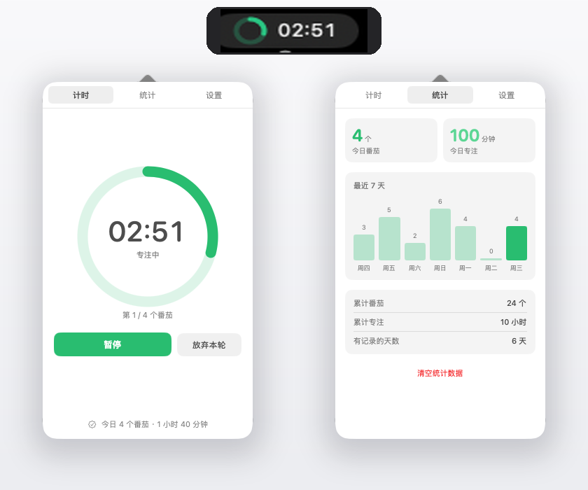

# 番茄环 TomatoRing

macOS 菜单栏番茄钟。原生 SwiftUI + AppKit 实现，**零第三方依赖**，只用 Command Line Tools 就能构建，不需要完整 Xcode。



## 功能

- **菜单栏圆环**：空闲时是一整圈实心绿环，专注时绿色进度弧，休息时蓝色，暂停变黄；旁边显示 `mm:ss`
- **番茄循环**：专注 → 短休息 → 专注 → … → 每 N 个番茄后进入长休息；可设置休息结束后自动停止
- **统计**：今日番茄数、今日专注分钟、最近 7 天柱状图、累计番茄 / 累计专注 / 有记录天数，可一键清空
- **时长可手动输入**：四个时长参数都能直接键入数字（回车生效，自动限制在 1–180 分钟），也可用步进器微调
- **提示音**：阶段结束时播放系统提示音（Glass），可关闭
- **系统通知**：专注结束带「跳过休息」、休息结束带「继续专注」按钮，可关闭
- **开机自启**：设置里一键开关，优先用 `SMAppService` 注册登录项，失败自动回退到 LaunchAgent
- **暂停 / 继续 / 放弃本轮 / 跳过休息**
- **URL 协议**：`tomatoring://startstop`、`show`、`stats`、`settings`、`skip`、`reset`、`loginon`、`loginoff`、`quit`，方便用快捷键或脚本控制

## 安装（下载版）

1. 从 Releases 下载 `TomatoRing-x.y.zip`，解压后把 App 拖进「应用程序」
2. 首次打开会被 Gatekeeper 拦下来（应用没有 Apple 公证），两种放行方式：
   - 右键点图标 →「打开」→ 再点一次「打开」
   - 或在终端执行：`xattr -d com.apple.quarantine "/Applications/TomatoRing.app"`
3. 需要 macOS 13 或更新；Apple 芯片和 Intel 都能跑（通用二进制）

> 想彻底去掉这个提示，需要 Apple Developer Program（$99/年）用 Developer ID 签名并做 notarization，见下方「发布」。

## 构建与安装

```bash
./build.sh            # 产出 build/TomatoRing.app（arm64 + x86_64 通用）
./build.sh --install  # 额外安装到 ~/Applications
open ~/Applications/TomatoRing.app
```

要求：macOS 13+，已安装 Command Line Tools（`xcode-select --install`）。脚本用 `swiftc` 直接编译、手工组装 `.app`、ad-hoc 签名，全程不调用 Xcode。

重新生成应用图标（需要带 Pillow 的 Python）：

```bash
python3 make_icon.py
```

## 使用

| 操作 | 效果 |
|---|---|
| 左键点菜单栏图标 | 打开/关闭面板 |
| 右键点菜单栏图标 | 上下文菜单（开始、跳过、统计、设置、退出） |
| 面板「计时」页 | 大圆环倒计时、暂停、放弃本轮/跳过休息 |
| 面板「统计」页 | 今日与历史数据、7 天柱状图 |
| 面板「设置」页 | 四个时长（可手动输入）、开机自启、提示音、通知（含权限与样式）、菜单栏倒计时、休息后停止 |

## 发布

```bash
./release.sh    # 编译 + 打包，产出 dist/TomatoRing-<version>.zip 和 .sha256
```

改好 `Resources/Info.plist` 里的 `CFBundleShortVersionString`，打 tag 推上去，GitHub Actions 会自动编译、打包并创建 Release：

```bash
git tag v1.0 && git push --tags
```

### 可选：签名与公证

```bash
codesign --force --deep --options runtime \
  --sign "Developer ID Application: YOUR NAME (TEAMID)" build/TomatoRing.app
ditto -c -k --keepParent build/TomatoRing.app TomatoRing.zip
xcrun notarytool submit TomatoRing.zip --keychain-profile "AC_PASSWORD" --wait
xcrun stapler staple build/TomatoRing.app
```

公证通过后，用户双击即可安装，不再有 Gatekeeper 提示，也可以提交到 Homebrew cask。

## 数据位置

- 统计：`~/Library/Application Support/TomatoRing/stats.json`（按天聚合，`pomodoros` / `focusMinutes` / `rests`）
- 偏好：`defaults read local.tomatoring`

## 代码结构

```
Sources/
  main.swift          NSApplication 启动
  AppDelegate.swift   状态栏项、弹窗、右键菜单、URL 协议
  TimerEngine.swift   状态机 + 基于结束时刻的计时（睡眠唤醒后不漂移）
  Settings.swift      UserDefaults 绑定
  StatsStore.swift    按天统计 + JSON 持久化
  LoginItem.swift     开机自启（SMAppService + LaunchAgent 回退）
  Notifier.swift      系统通知 + 提示音
  Support.swift       菜单栏圆环绘制、时间格式化、配色
  PopoverRoot.swift   面板容器与标签栏
  TimerView.swift     计时页
  StatsView.swift     统计页
  SettingsView.swift  设置页
```

计时用 `DispatchSourceTimer` 每 200ms 触发，但剩余时间由「结束时刻 − 当前时刻」算出，不累加 tick，所以休眠唤醒、定时器被延迟都不会累积误差；超时超过 3 分钟则判定为长时间休眠，直接回到空闲而不是连跳两个阶段。

## 与 TomatoBar 的关系

交互上参考了 [ivoronin/TomatoBar](https://github.com/ivoronin/TomatoBar)（MIT），但代码是独立重写的：没有引入 SwiftState / KeyboardShortcuts / LaunchAtLogin，状态机换成普通 `enum` + `switch`，菜单栏圆环用 `NSBezierPath` 现画（TomatoBar 用的是位图资源），提示音改用系统音效。

## 通知按钮为什么只在悬停时出现？

「系统设置 → 通知 → 番茄环 → 提醒样式」有两个选项：**临时**和**持久**。临时样式的通知会自动消失，操作按钮只在悬停时出现；换成**持久**，通知会停留到手动处理，按钮也就常显。

## 收不到系统通知？

应用已正确授权（设置页会显示「通知权限 已允许」，每次打开面板都会重新读取系统状态）。如果通知只在通知中心里、屏幕上不弹，通常是因为**投递的那一刻番茄环自己正处在前台活跃状态**（面板开着），macOS 会把这种通知静默处理。

现在阶段结束时会先收起面板并让出前台，再投递通知。若依然不弹，检查「系统设置 → 通知 → 番茄环」的样式（横幅/提醒）以及是否处于专注模式。

## 已知限制

- 应用是 ad-hoc 签名，首次启动后系统通知权限需要在「系统设置 → 通知」里手动允许；分发到其他机器会被 Gatekeeper 提示，需要右键打开
- 计时状态不跨重启保留
